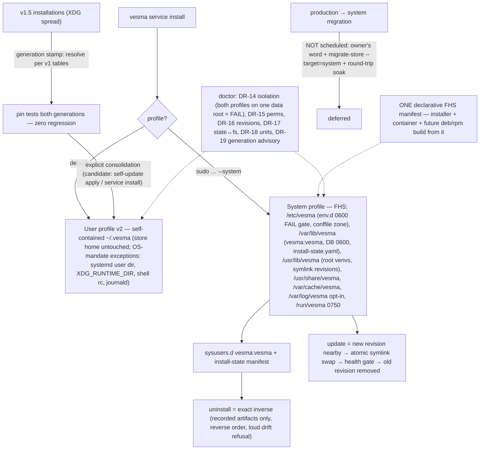

# ADR 0045: Dual-profile installation — a self-contained user profile (`~/.vesma`), an FHS system profile, and the single FHS manifest (layout v2)

**Status:** Accepted — ArchCom 2026-10-21 (the dual-profile FHS session;
wave 1 of the verdict is these documents themselves: the layout v2 spec
`2.0.0-draft.1` in vesma-specs plus this ADR). The owner's
user-profile self-containment directive (one tree in `~/.vesma/**`, the
`~/.vscode`/`~/.nvm` precedent) is folded into the ratified form as an
amendment of the same decision cycle and is recorded inline. Implementation
follows the Rollout wave plan; production migration to the system profile
stays locked until a separate owner's word.

**Deciders:** ArchCom 2026-10-21 — Tech Lead (chair); the full participant
list and the criticism phase are in the session protocol (team-local,
referenced below). The user-profile self-containment amendment is the
owner's directive folded in before publication.

**Scope:** the installation model of the engine: the dual-profile rule and
its first-class install-time choice; the user profile v2 as a
self-contained `~/.vesma/**` tree with an explicit list of OS-mandated
exceptions; the v1.5 XDG-spread form as the pinned legacy generation; the
system profile as a full FHS table (`/etc/vesma`, `/var/lib/vesma`,
`/usr/lib/vesma`, `/usr/share/vesma`, `/var/cache/vesma`, opt-in
`/var/log/vesma`, `/run/vesma`); the single declarative FHS manifest as the
source of truth for the installer, the container build and future deb/rpm;
the system install/uninstall/update mechanics (`vesma service install
--system`, sysusers.d, the install-state manifest, `uv venv` + the
same-build wheel, symlink-swap updates); unit coexistence without prefixes
and profile-derived IPC; doctor gates DR-14…DR-19; the ecosystem placement
table; the channel policy (pip remains the code channel; deb/rpm a future
thin-wrapper wave); the migration policy (a non-breaking v1.5 → v2
consolidation; the production mover deferred). Out of scope: the
implementation itself (the rollout waves), executing any migration, the
deb/rpm packaging wave, the hash-pinning mandate and lock tooling (the v1
§7 deferral stands), secret redaction in forwarded lines (SL §6), and the
`migrate-store --target=system` target contract (a separate ratification
at activation time).

**Preconditions:** layout v1 ratified and implemented (the user profile;
runner 24/24, checklist LY-01…LY-14 green, 2026-10-05); the store home
flip landed (`~/.mnemos` → `~/.vesma` everywhere in code, the ADR-0044
mover shipped); the 7-pillar product-grade distribution standard adopted
as the product bar; the container channel publishing; the v1.5 service
stack canon (`~/.config/vesma`, `~/.local/share/vesma`,
`~/.local/state/vesma`, `~/.cache/vesma`) as the consolidation baseline.

## Context

Three pressures converged on the installation model.

**The channel ceiling.** The engine installs today as a per-user stack
only. The 7-pillar product-grade standard demands idempotent install,
exact-inverse uninstall, mode-aware update, state tracking and
multi-channel publishing — and every one of those pillars is currently
user-shaped. System-grade deployments (shared/multi-user hosts, containers
built as system images, future deb/rpm packages) expect FHS discipline:
config in `/etc`, state in `/var/lib`, code in `/usr/lib`, logs in
journald. Layout v1 §3.3 held a system-profile design-reference table, but
its implementation was deferred, and the v1 shape cannot carry the pillar
work.

**Two homes for one product.** The user profile is an XDG spread
(`~/.config|~/.local/share|~/.local/state|~/.cache`, each with a `vesma/`
subtree) sitting next to the engine store home `~/.vesma` — which the 6.0
home flip made self-contained (config, data, vault, logs, completion,
`vesma.db` all in one tree). The result: one product, two homes; backup,
uninstall and audit surfaces split across both. The owner directed the
consolidation: the user profile becomes **self-contained in
`~/.vesma/**`**, with the `~/.vscode`/`~/.nvm` dot-directory precedent —
except where the OS mandates otherwise, as an explicit list.

**The migration cliff.** Any layout change lands among live user
installations. The v1 experience (the mover gates, the fork-refusal
precedent) fixed the discipline: a canon change must never silently
rewrite a working installation, and a production cutover never runs
without gates and soak.

The committee ratified dual-profile with the FHS system profile and the
single declarative manifest; the owner's self-containment directive was
folded in before publication. Everything else in the session brief — the
system tables, journald primary, `install --system`, the deferred
production migration — is unchanged.

## Decision

**1. Dual-profile installation; the profile is a first-class product
choice.** `vesma service install` (no flags) installs the user profile —
the canon and the default. The system profile is installed only
explicitly: `sudo vesma service install --system`. The profile and the
layout generation are stamped at install time and read by the resolver,
doctor and the CLI; silently switching the profile of an existing
installation is forbidden. The user and system profiles of one machine
have distinct data roots; pointing both at one data root is a
configuration error — doctor FAIL (DR-14, the verdict's "ERROR"). Paths
are resolved only by the engine resolver from the layout tables and the
generation stamp; hardcoded paths outside the resolver violate the
contract.

**2. The user profile v2 is self-contained in `~/.vesma/**`.** One tree,
one unit of backup, removal and audit:

| Path | Contents | Mode |
|---|---|---|
| `~/.vesma/config.yaml` | shared config | `0600` |
| `~/.vesma/components.d/<name>.yaml` | component manifests (drop-in) | dir `0700` |
| `~/.vesma/env.d/<name>.env` | env secrets, fail-closed | file `0600` |
| `~/.vesma/components/<name>/` | component data, default cwd, `config.schema.json` | dir `0700` |
| `~/.vesma/venv/` | engine venv (supervisor + in-process) | dir `0700` |
| `~/.vesma/venvs/<name>/` | python child venvs | dir `0700` |
| `~/.vesma/logs/<name>/` | file logs (files-under-state only), rotation 10 MB × 5 | dir `0700` |
| `~/.vesma/history/` | supervisor transition journal (append-only) | dir `0700` |
| `~/.vesma/run/` | runtime fallback (empty `XDG_RUNTIME_DIR`) + WARN | dir `0700` |
| `~/.vesma/cache/<name>/` | regenerable, never secrets | dir `0750` |
| `~/.vesma/systemd/user/vesma.service` | canonical unit storage | dir `0700` |
| `${XDG_RUNTIME_DIR}/vesma/` | canonical runtime (`control.sock` `0600`, pids) | dir `0700` |

The engine store home already in `~/.vesma` (`vesma.db`, `data/`,
`vault/`, `config.yaml`, `completion/`, top-level `logs/`) is NOT
replayed — the ADR-0044 canon stands; the service stack embeds into the
same tree. The **OS-mandated exceptions are a closed list**: (a) the
systemd user unit dir `~/.config/systemd/user/` (systemd reads units only
there — the canonical storage lives in `~/.vesma/systemd/user/` and the
install flow links/copies it in); (b) `${XDG_RUNTIME_DIR}/vesma/` (sockets
belong on a runtime FS; the `~/.vesma/run/` fallback + WARN rule of v1 is
preserved); (c) shell rc completion lines (an external surface,
documented, not owned); (d) journald as the log sink (an OS service, not a
path). No other XDG variable participates in the v2 user resolution.
Component names are validated against a reserved-name registry of the tree
(`venv`, `venvs`, `components`, `components.d`, `env.d`, `cache`, `logs`,
`history`, `run`, `completion`, `systemd`, `data`, `vault`,
`install-state.yaml`).

**3. Existing v1.5 installations keep working — the legacy generation is
normative.** Installations deployed in the v1 XDG-spread form are stamped
generation `v1.5` and resolve per the v1 tables until an explicit
consolidation runs (Decision 9). New user installations are always v2. The
engine never writes v1.5 paths into a v2 installation or vice versa; a
mixed tree is doctor FAIL (DR-17). Zero-regression is enforced by pin
tests for both generations (rollout wave 1).

**4. The system profile is a full FHS implementation.**

| Path | Contents | Mode/owner |
|---|---|---|
| `/etc/vesma/` | configuration root | `0750 root:vesma` |
| `/etc/vesma/config.yaml` | shared config | `0640 root:vesma`, conffile |
| `/etc/vesma/components.d/<name>.yaml` | manifests (drop-in) | `0640 root:vesma`, conffile |
| `/etc/vesma/env.d/<name>.env` | env secrets | `0600 root:vesma`¹ — doctor FAIL gate |
| `/usr/lib/sysusers.d/vesma.conf` | creates `vesma:vesma` | `0644 root:root` |
| `/etc/systemd/system/vesma.service` | system supervisor unit | `0644 root:root` |
| `/usr/lib/vesma/venv/`, `venvs/<name>` | root-owned venvs, symlink revisions | tree `0755 root:root` |
| `/usr/share/vesma/` | distro static (bundle manifests, schemas, unit templates, completion) | `0755`/`0644 root:root`, read-only at runtime |
| `/var/lib/vesma/` | data root: the engine store home + component data | `0750 vesma:vesma` |
| `/var/lib/vesma/vesma.db` | store DB | `0600 vesma:vesma` |
| `/var/lib/vesma/history/` | supervisor journal | `0750 vesma:vesma` |
| `/var/lib/vesma/install-state.yaml` | install state → exact-inverse uninstall | `0640 root:vesma` |
| `/var/cache/vesma/<name>/` | cache | `0750 vesma:vesma` |
| `/var/log/vesma/<name>/` | file logs — opt-in only; journald is primary | `0750 vesma:vesma` |
| `/run/vesma/` | IPC: `control.sock`, pids | `RuntimeDirectory=vesma`, `RuntimeDirectoryMode=0750` |

¹ The env.d owner is the account the supervisor reads under (design
default `root:vesma`; the final pin belongs to the units wave). The
normative invariant: `0600`, no group/world read, only the supervisor
service account reads, loading fail-closed, any drift a doctor FAIL.

The `vesma-oper` group of the v1 §3.3 design table is NOT introduced;
operator group access to the system socket is an open question of the
units wave — until then, system-IPC access is root.

**5. One declarative FHS manifest is the single source of truth.** The
distribution ships exactly one manifest enumerating every system-profile
path with its user correspondence: `role`, `user_path`, `system_path`,
`mode`, `owner`, `group`, `flags` (`conffile`, `opt-in`,
`symlink-revision`, …). Consumers: the `install --system` installer, the
container build, future deb/rpm packaging — each builds artifacts from the
manifest, never from private path lists; engine code resolves system paths
only through it. An operator MAY override the placement base (e.g. an
`/opt/vesma` shape) through an explicit, validated override mechanism.

**6. System mechanics: idempotent install, exact-inverse uninstall,
mode-aware update.** `sudo vesma service install --system` is the only
canonical installer; re-runs never duplicate artifacts. The service
account comes from the sysusers.d fragment. Every created artifact is
recorded in the install-state at/before creation; uninstall removes
exactly the recorded artifacts in reverse order, never touches foreign
files, and refuses loudly on state ↔ filesystem drift (DR-17). Updates
materialize the new venv revision nearby and swap the `venvs/<name>`
symlink atomically; the previous revision is removed only after a
successful swap and a health check. venvs are materialized by the
installer with `uv venv` + the wheel of the same build the installer runs
from — `pip` as root is forbidden, foreign venvs are never written (the
owner's environment-isolation global rule 8).

**7. Units coexist without prefixes; IPC is profile-derived.** User and
system units are both `vesma.service` in their systemd scopes; they are
distinguished by scope, not name. User IPC is `${XDG_RUNTIME_DIR}/vesma/`
(fallback `~/.vesma/run/` + WARN); system IPC is `/run/vesma/` with
`RuntimeDirectoryMode=0750`.

**8. Every ecosystem artifact embeds in the one structure — both
profiles.** The engine (supervisor, API, MCP server/entrypoint), in-process
bundle components (board, metrics), agent children, python children
(own venv), non-python children (binary, no venv), and timer units all map
onto the tables above; a new ecosystem entity joins through the placement
table, additively. Integration surfaces in foreign harnesses (mcp.json,
shell rc lines) are **external**: documented as pointing at the canonical
paths, owned and maintained by their own integration flows, not by the
layout.

**9. Migration: consolidate without breaking; migrate production only on
the owner's word.** The v1.5 → v2 consolidation is an explicit operator
step (candidate vehicles: an extension of `vesma self-update apply` /
`vesma service install`), executing as stop → verified move of venv/cache
and the service stack into `~/.vesma` → generation re-stamp → green doctor
— the ADR-0044 staging → verify → publish discipline; a working v1.5
installation without consolidation keeps working. The production migration
into the system profile is NOT part of any scheduled wave:
`vesma migrate-store` reserves `--target=system`, the target contract gets
its own ratification, and activation requires the owner's word plus a
system-profile round-trip soak (full install → run → update → uninstall →
restore cycles; pillar 7 of the product-grade standard).

**10. Channels: pip stays the code channel; deb/rpm are future thin
wrappers.** The packaging wave introduces no packaging logic of its own —
deb/rpm consume the same FHS manifest (conffile declarations included) and
wrap the canonical installer.

## Rollout

Wave 1 (this change) is documents only: the layout v2 spec
(`2.0.0-draft.1`, specs repo branch) and this ADR. The implementation
waves run in order, each gated by `make verify` plus the green
conformance items it owns, full suites sequentially:

1. **Resolver + pin tests** — the v2 user resolver (self-contained
   `~/.vesma`), the generation stamp mechanism, pin tests for BOTH
   generations (zero-regression proof), the reserved-name registry;
   conformance LY-01…LY-16.
2. **`install --system`** — sysusers fragment, the FHS manifest consumer,
   the install-state writer, `uv venv` + same-build wheel
   materialization; conformance SY-01…SY-04, SY-08, SY-09.
3. **Doctor + update** — DR-14…DR-19, the symlink-swap updater, the
   conffile discipline; conformance SY-05…SY-07, SY-10…SY-11.
4. **The mover wave** — the consolidation vehicle (v1.5 → v2), the
   `migrate-store --target=system` reservation; conformance SY-12.
5. **deb/rpm** — thin wrappers over the same manifest (a separate
   ratification of the packaging wave).

The production cutover is outside this plan until the owner says
otherwise.

## Consequences

**What becomes true:**

- The product satisfies the distribution pillars on both shapes: idempotent
  install, exact-inverse uninstall (state-tracked), mode-aware update
  (symlink swap + health gate), and a packaging-grade path for containers
  and future deb/rpm from one manifest.
- The user installation is one tree: backup, removal and audit of
  `~/.vesma` covers the product end to end (minus the four OS-mandated
  exceptions, each explicitly listed).
- Layout v2 is a MAJOR spec (`2.0.0`) whose breakage is contained by the
  generation stamps: deployed v1.5 installations stay conformant and
  green.
- journald remains the only default log sink in both profiles;
  `/var/log/vesma` exists solely as a system opt-in — the v1 "no third
  log places" rule survives intact.

**Costs:**

- The resolver, installer, doctor and CLI carry two user generations
  (v1.5 legacy + v2) and two profiles until the consolidation and soak
  close — a doubling of the path/test surface, deliberate and pin-tested.
- The system profile adds a root/service-account boundary (sysusers,
  install-state, root-owned venvs) that the user profile never had — new
  doctor checks and new failure classes to document.
- The reserved-name registry and the FHS manifest become contract
  surfaces: additive growth only, MAJOR to narrow.

**Risks accepted:**

- The dual-home transition (v1.5 and v2 shapes coexisting across machines)
  is the largest standing ambiguity. Mitigation: generation stamps,
  pin tests for both shapes, DR-17 (mixed tree = FAIL), DR-19 (advisory
  with the consolidation command), and the explicit non-breaking
  consolidation discipline.
- The env.d system owner depends on the not-yet-decided unit `User=`;
  until the units wave pins it, the invariant (0600, supervisor-only
  readable) is enforced instead of the concrete owner string.
- Non-root operator access to the system socket is unavailable while the
  `vesma-oper` question is open — accepted for the system profile's first
  waves; root is the operator there.

## Alternatives considered

| Alternative | Why rejected / deferred |
|---|---|
| FHS-only (system profile as the single form) | Rejected: the root requirement kills the four no-root channels (pip/user install, uv tool, pipx, container-as-user) and nullifies the fresh `~/.vesma` home flip — the product's default audience is per-user. |
| `/opt/vesma` as the system base | Rejected as the default: inconsistent with splitting the rest across `/etc`, `/var/lib`, `/usr/lib`, `/var/log` — a monolithic `/opt` tree recreates the two-homes problem at the system level. Tolerable as an explicit operator override through the manifest's override mechanism (Decision 5). |
| Immediate production migration into the system profile | Rejected: no soak exists yet; the production store is live user-profile data. The mover extension is reserved, the target contract gets its own ratification, and activation waits for the owner's word plus a round-trip soak. |
| Keep the v1 XDG-spread user profile (no consolidation) | Superseded by the owner's directive: one product must not live in two homes — the XDG spread splits backup/uninstall/audit across four trees next to the self-contained store home. The v1 form is retained as the pinned legacy generation, never as the canon. |
| Prefixed unit names (`vesma-system.service`) to ease coexistence | Not adopted: systemd scopes already distinguish user and system units of the same name; prefixes would leak the profile into every command surface instead of deriving IPC and scope from the profile. |

## References

- Layout spec v2 `2.0.0-draft.1` —
  `specs/layout/v2/` in
  [vesmaro/vesma-specs](https://github.com/vesmaro/vesma-specs) (branch
  `spec/layout-v2`, wave 1); layout v1 remains immutable in
  `specs/layout/v1/` as the legacy-generation norm.
- [ADR-0044](0044-store-migration.md) — the store mover whose
  staging → verify → publish discipline and explicit-only philosophy are
  carried into the consolidation and the reserved system mover.
- [ADR-0031](0031-rebrand-mnemos-to-vesmaro.md) — the home-flip lineage
  (`~/.mnemos` → `~/.vesma`) that Decision 2 builds upon.
- ArchCom protocol 2026-10-21 «dual-profile FHS layout» — positions,
  criticism phase, rejected alternatives; team-local (Tech Lead).
- The 7-pillar product-grade distribution standard (GCW canon,
  `product-grade-distribution`) — pillars 2, 3, 4, 5 and 7 are the
  acceptance frame of Decisions 5, 6 and 9.
- [FHS 3.0](https://refspecs.linuxfoundation.org/FHS_3.0/fhs/index.html);
  systemd [sysusers.d](https://www.freedesktop.org/software/systemd/man/latest/systemd-sysusers.html)
  and [RuntimeDirectory](https://www.freedesktop.org/software/systemd/man/latest/systemd.exec.html).
- CHANGELOG, [Unreleased] — this ADR's entry (document-only wave).
