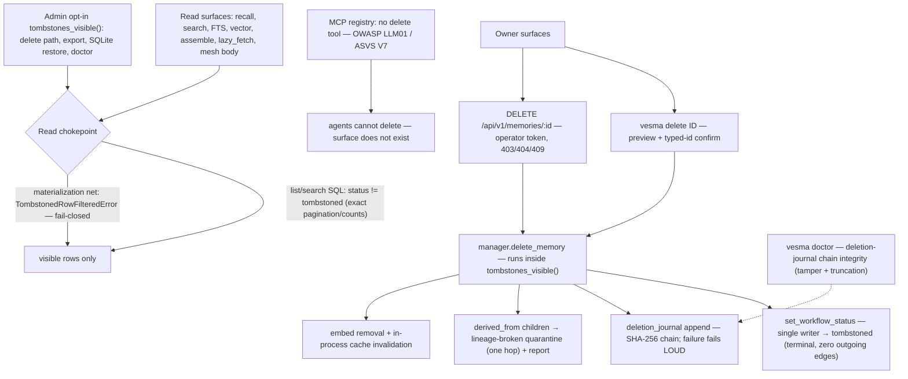

# ADR 0046: Memory deletion — tombstone Stage 1 (terminal workflow state, dual chokepoints, owner-only surfaces, hash-chained deletion journal)

**Status:** Accepted — ArchCom 2026-10-18 (ratified form, mnemos 24f32fa7);
Stage 1 spec amended by the ArchCom verdict of 2026-10-20 (mnemos a15948ce;
amendments folded into the task card, mnemos eabe85a4) and **implemented** —
Stage 1 landed on the `feat/tombstone-s1` branch (7 commits on the
test-isolation base). This ADR records the ratified Stage 1 form. Stage 2
(hard purge) and Stage 2.5 (`gc --orphans`) are gated future work outside
this ADR's scope.

**Deciders:** ArchCom 2026-10-18 — Tech Lead (chair); the full participant
list and the criticism phase are in the session protocol (team-local,
referenced below). The 2026-10-20 amendments are the senior-engineer spec
corrections ratified by the same committee's weekly-plan verdict.

**Scope:** the memory deletion mechanism of the engine: the terminal
`tombstoned` workflow state on the existing `workflow_status` column; the
write chokepoint (`set_workflow_status` as the column's single writer); the
parameterized read chokepoint (default filter + fail-closed materialization
net + explicit admin opt-in); the owner-only delete surfaces (interactive
CLI, REST; no MCP surface by construction); the append-only hash-chained
deletion journal and its integrity check; `derived_from` lineage quarantine;
the no-resurrection contract and its test ring; the documented Stage 1
remainders. Out of scope: Stage 2 hard purge (the embeddings/ccr/dlq/swap/
edges cascade, the `content_hash` migration, verification sweep, peer-ack
discipline), Stage 2.5 orphan reaping, undelete (none exists in Stage 1),
retrospective cleanup of historical records, and any change to the
federation protocol (the peer-side `content_state=tombstoned` handling
predates this ADR).

**Preconditions:** the append-only store canon (no native delete path since
the fork); the `workflow_status` column already in production (the 2026-10-20
amendment pinned the symbols: the column definition and migration registry in
`src/vesmaro/storage/sqlite_store.py`, the write side `set_workflow_status`);
federation already ships peer-side tombstone handling (`content_state=
tombstoned`, lazy-fetch skip, origin guard); the test-isolation wave-1
baseline green (the ArchCom start gate for this task).

## Context

Three facts forced the decision.

**There is no legal way to delete a record.** Vesma's store is append-only
by design: no CLI, MCP, REST or store method removes a memory. When the
owner requested deletion of 13 session records on 2026-10-18, the only path
was manual SQL surgery across `memories`, the vectors database and
`workflow_history`, plus an FTS rebuild — recorded as a TEMP-WORKAROUND that
this feature replaces going forward. The surgery class has no auth, no audit,
no atomicity, and requires a skill an operator should never need.

**Workflow withdrawal does not hide a record.** A live check on 2026-10-18
confirmed that a `withdrawn` memory still surfaces in `recall_context` —
withdrawal is a lifecycle state, not an erasure. The only complete wipe was
`import --restore` against an empty export, which destroys the whole
database.

**Deletion has known resurrection paths.** The committee inventory found
records that come back after a naive `DELETE`: the DLQ retry scheduler,
swap artifacts (`swap_key`), the ccr cache, export backups re-imported, and
in-process caches. An erasure claim ("deleted = surfaces nowhere") is false
unless every one of these paths is closed or guarded.

The committee ratified a tombstone-first, two-stage design: Stage 1 soft
delete (this ADR), Stage 2 hard purge gated by owner confirmation and peer
acks. The 2026-10-20 verdict amended the Stage 1 spec (reuse the existing
column, parameterize the read chokepoint with explicit admin opt-in, rank
the concessions) and fixed the non-negotiable core: the terminal state +
chokepoints, the no-bypass test, owner-only authz, and the hash-chained
journal.

## Decision

**1. `tombstoned` is a terminal workflow state on the existing column — no
new column.** The 2026-10-20 amendment replaced the "schema migration" item:
the `workflow_status` column already exists; the schema story is the terminal
state in the workflow state machine plus a pin test. Deletion knows no
workflow state — `tombstoned` is enterable from ANY state (from a
workflow-terminal state it is the ONLY edge out). `tombstoned` itself has
zero outgoing edges: there is no undelete in Stage 1. The generic workflow
transition surface (`MemoryManager.workflow_set`) refuses `tombstoned`
server-side — a delete cannot be smuggled through the lifecycle API, and the
lifecycle API cannot undo a delete.

**2. One write chokepoint.** `set_workflow_status` remains the column's
single writer; `update_fields`/`save()` cannot touch `workflow_status`. The
delete path goes through the same chokepoint as every workflow transition —
the column has no other writer.

**3. One parameterized read chokepoint, fail-closed.** Every read path
hides tombstoned rows by default at two layers:

- the SQL layer: list/search queries carry `workflow_status != 'tombstoned'`
  (get, list_all, list_recent_for_agent, list_by_cluster, FTS search, mesh
  listing, refine intake/claim, pipeline-state listing — pagination and
  counts stay exact);
- the materialization net: a tombstoned row reaching row-to-memory
  conversion without opt-in raises `TombstonedRowFilteredError` — a
  fail-closed guard that also covers FUTURE unmarked read paths;
  `store.get` extends the same protection to the edge-neighbour callers
  (vector/FTS/walk fusion backends) for free.

A negative no-bypass test pins that every unmarked path filters.

**4. Admin opt-in is explicit and scoped — `tombstones_visible()`.** Admin
surfaces deliberately see tombstoned rows; anything else that needs them
must opt in or fail. The surface table:

| Surface | Sees tombstoned? | Mechanism / posture |
|---|---|---|
| Delete path (`manager.delete_memory`) | yes, scoped | `tombstones_visible()` + `get(include_tombstoned=True)`; a second delete is an idempotent no-op |
| Export (JSON backup, SQLite snapshot) | yes — intentional | backups must carry the tombstone marker, or a restore would resurrect |
| Import merge (JSON and SQLite legs) | rows skipped | no-resurrection filter before any write |
| SQLite-snapshot restore | lossless | raw file swap preserves the columns; the post-swap gate keeps tombstoned rows hidden |
| JSON import restore leg | rows skipped | safe-direction lossiness, documented — the lossless leg is the SQLite snapshot |
| Sync compact payload | content excluded | guard-refusal posture (Stage 1): deleted content never ships |
| Mesh metadata leg | marker propagated | a tombstoned memory maps to `content_state=tombstoned`; the peer's lazy-fetch already skips it (pre-existing peer behavior) |
| Doctor | yes | journal integrity + counting (counting is a documented remainder) |

**5. Deletion is owner-only.** Two surfaces exist; agents get none.

- CLI: `vesma delete <id>` — preview + typed-id confirmation; `--yes` for
  non-interactive scripts.
- REST: `DELETE /api/v1/memories/{id}` — operator session/token level
  (ADR-0014 conventions): 403 for a non-operator context, 404 unknown
  memory, 409 state-machine/journal violations.
- MCP: the tool registry carries **no** memory-delete tool. An agent cannot
  be granted what does not exist — a prompt-injectable principal must not
  hold an erasure capability (OWASP LLM01 / ASVS V7).

Deletion runs only through the live server; out-of-band SQL is outside the
contract (it would skip cache invalidation and journaling).

**6. Every deletion appends one hash-chained journal entry.** The new
`deletion_journal` table records metadata only — never content: sequence,
journal id, memory id, actor, reason, quarantined descendants, timestamps,
and SHA-256 chain hashes (`prev_hash`/`entry_hash` over
prev|id|memory|ts|actor|reason|descendants; genesis 64 zeros). The journal
is append-only by construction: no store method, CLI, MCP or REST path can
update or remove its rows (pinned by tests). A failed journal append fails
loud — an unjournaled tombstone is an integrity gap the owner must see.
Chain integrity (tampering AND tail truncation) is verified by a standard
`vesma doctor` check, green on a clean base, failing on a forged entry.

**7. `derived_from` children are quarantined, not cascaded.** Children of a
tombstoned parent get the `lineage-broken` quarantine reason (the existing
terminal quarantine lane; explicit release stays intact) one hop out, and
the owner receives a report (`descendants_quarantined` /
`descendants_skipped`). There is NO transitive cascade in Stage 1 — an
explicit cascade command is a later stage (first item of the 2026-10-20
concession order).

**8. No-resurrection is a tested contract.** Pins cover the DLQ retry
scheduler (leaves the row deleted), the pipeline sweeper/intake/claim
(never pick the row), the mesh body export (never serves it), both import
legs (skip tombstoned), and the generic transition refusal. Cache hygiene
on delete: embed removal plus in-process aggregate-cache invalidation; the
ccr cache needs nothing by construction (content-addressed, no memory-id
linkage — Stage 2 migrates a `content_hash` when purge must reach it).

**9. Conformance ring.** `tests/test_tombstone_delete.py` — 52 tests:
the surface-by-tombstone conformance matrix, the write/read chokepoints,
the no-bypass negative, journal tamper/truncation, authz, lineage,
no-resurrection, migration-on-copies.

### Staged future work (outside this ADR's scope)

- **Stage 2 — hard purge** (gated: green Stage 1 + peer acks, or owner
  override with the residual risk recorded in the journal): dry-run →
  cascade (vectors, ccr by `content_hash`, dlq, swap artifacts, edges,
  traces) → row DELETE → verification sweep → residual report. Prerequisite:
  the `content_hash` migration for the content-addressed ccr cache.
- **Stage 2.5 — `vesma gc --orphans`**: the reaper for crash windows during
  an interrupted purge cascade.

## Consequences

**What becomes true:**

- The owner has a legal "delete my records" path: erasure on every read
  surface means "surfaces nowhere"; the 2026-10-18 TEMP-WORKAROUND is
  replaced for all future deletions (retrospective cleanup stays out of
  scope).
- Read visibility is a perimeter, not a per-feature patch: every future read
  path must route through the chokepoints, and the fail-closed
  materialization net plus the no-bypass pin test enforce the perimeter over
  code that does not exist yet. The guarded SQL surface is large by design
  (the amendment counted 53 `FROM memories` sites — 40 in the store, 13
  outside).
- The deletion journal is a contract surface: append-only, additive growth
  only, integrity check in doctor. It carries the audit provenance (actor,
  reason, descendants) the manual surgery never had.
- Tombstoned rows remain in the database file until Stage 2 — Stage 1 is
  logical erasure, not physical erasure; disk, backups and the SQLite
  snapshot still hold the bytes (backups carry the marker so a restore stays
  safe).

**Documented remainders (accepted, named in code):**

- Aggregates and statistics (row counts, tag frequencies, status breakdowns,
  search stats, doctor counts) still count tombstoned rows — the MVP
  decision on filtering each consumer is deferred, in docstrings, not
  hidden.
- The awareness heartbeat probe can still see a tombstoned row (it exists
  and is not archived): the heartbeat stays a cheap over-approximation —
  the rows it gates are filtered at materialization, so a tombstone can at
  most trigger one empty compose, never leak content.
- `replace_doc_chunks` (the docs-ingest rewrite path) is a purge-class
  DELETE today; it rides the journal only in Stage 2.
- The JSON import legs are safe-direction lossy (tombstoned rows skipped);
  the lossless restore leg is the SQLite snapshot swap.
- The compact sync payload ships no deleted content (guard-refusal posture);
  marker propagation rides the mesh metadata leg only.
- Upstream LLM provider KV-caches and other out-of-process copies are beyond
  reach — the erasure guarantee stops at the process boundary.

**Costs:**

- The two-layer filter doubles the SQL predicate surface and adds a second
  failure mode on read paths (`TombstonedRowFilteredError` for a caller that
  forgot to opt in) — deliberate: the failure is loud at the first missing
  annotation, not silent at the hundredth bypass.
- Every aggregate consumer eventually needs a filter-or-not decision — the
  deferral is documented per site, which is a standing review tax until
  Stage 2 rationalizes it.

## Alternatives considered

| Alternative | Why rejected / deferred |
|---|---|
| One-shot hard `DELETE` now | Rejected for Stage 1: proven resurrection paths (sync peers re-exporting, DLQ retry, swap artifacts, caches) make the erasure claim false; the row's audit context is lost; the federation `content_state` model expects a tombstone marker first. Hard purge returns in Stage 2 with the cascade, verification sweep and peer-ack gate. |
| Hiding at the manager level only (no store chokepoint) | Rejected: the read surface is dozens of SQL sites across store, manager, API, CLI and import/export — patching each invites the silent-bypass class; the chokepoint + fail-closed materialization net closes present and future paths and makes a missed annotation fail loudly. |
| A separate `is_deleted` boolean column | Rejected: a second visibility vocabulary next to `workflow_status` — two sources of truth for "gone". The workflow state machine already owns the lifecycle; a terminal state gives the undelete-forbidden semantics for free and reuses a column that already exists. |
| Full purge (Stage 2) implemented immediately | Deferred by the committee (the Stage-2 depth dispute resolved by the chair): both stages stay in one task, but Stage 2 is gated — owner confirmation + dry-run, peer acks or a recorded owner override, and the `content_hash` migration prerequisite. |
| Crypto-shredding by default | Rejected (ArchCom 2026-10-18): breaks federation and audit paths for a property Stage 1 does not need. |
| Status quo (manual SQL surgery per request) | Rejected: no auth, no audit, non-atomic, skill-dependent — the exact TEMP-WORKAROUND class this decision retires. |

## References

- Task card `vesma-delete-tombstone-purge` (gcw-task-manager board; store
  mirror mnemos `eabe85a4-dad2-45ca-a74e-7d0c36b97b90`) — the Stage 1 spec
  and the «Поправки АрхКома 2026-10-20» amendment section.
- ArchCom decision 2026-10-18 — mnemos `24f32fa7-72d9-49ab-801a-430884ca218f`
  (`vesma:decision`, committee tag); session protocol
  `~/.gcw/architectural-committee/2026-10-18-vesma-delete-mechanism.md` +
  contract (team-local; the protocol file was not found on disk at dispatch
  time — the mnemos card is the citable record).
- ArchCom verdict 2026-10-20 (weekly plan; the Stage 1 amendments) — mnemos
  `a15948ce-6629-4ea6-ab74-bb0ff77ce4bd`; protocol
  `~/.gcw/architectural-committee/2026-10-20-vesma-session-plan.md`
  (team-local).
- [ADR-0014](0014-api-auth-threat-model.md) — the owner/operator
  authentication conventions the REST delete surface enforces.
- OWASP [Top 10 for Large Language Model Applications](https://owasp.org/www-project-top-10-for-large-language-model-applications/)
  (LLM01: Prompt Injection) and [OWASP ASVS](https://owasp.org/www-project-application-security-verification-standard/)
  (V7) — the rationale for the MCP delete-tool ban.
- Implementation: branch `feat/tombstone-s1` (Stage 1; commits `daa0217`…
  `0bfc521` on the test-isolation base) — `src/vesma/workflow.py`,
  `src/vesma/storage/sqlite_store.py`, `src/vesma/manager.py`,
  `src/vesma/compact.py`, `src/vesma/cli/main.py`,
  `src/vesma/cli/import_.py`, `src/vesma/cli/doctor.py`,
  `src/vesma/api/main.py`, `tests/test_tombstone_delete.py`.
- CHANGELOG, [Unreleased] — the Stage 1 delete entry (lands with the
  implementation branch).
