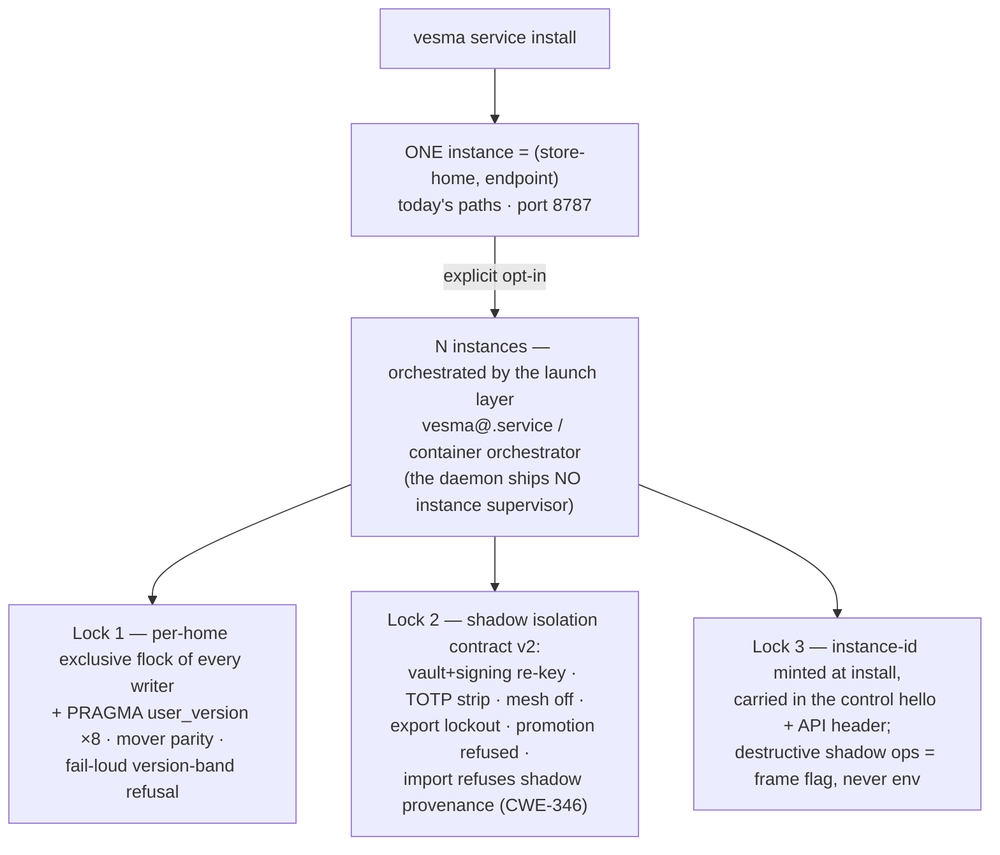

# ADR 0049: Multi-instance store architecture — an instance is the pair (store-home, endpoint); three locks gate multiplicity

**Status:** Accepted — ArchCom 2026-10-27 (the multi-instance store session;
convened on the owner's request of 2026-10-27). All seats returned ACCEPT:
Tech Lead (chair), Product Architect, Senior DBA, Senior Security Engineer,
SRE/DevOps, Senior System Engineer. Waves 1–3 are gated by the three locks of
Decisions 2–4 — multiplicity is **not shippable without any one of them**.
Authored ahead of the ADR-0048 installer-lane merge by the Tech Lead's call;
wave 1 bases on the merged ADR-0048 tree (see Rollout).

**Deciders:** ArchCom 2026-10-27 — Tech Lead (chair), Product Architect,
Senior DBA, Senior Security Engineer, SRE/DevOps, Senior System Engineer.
Positions and the criticism phase are in the session protocol (team-local,
referenced below); the normative isolation contract is the session's
companion contract document (team-local).

**Scope:** the instance model of the server (non-container) installation —
what "an instance" is (the pair store-home + endpoint), the default of one,
multiplicity as explicit opt-in, the three admission locks (per-home writer
lock + schema stamps; the shadow-instance isolation contract v2; instance
identity in the management plane), the instance registry, machine-wide
disk-transit accounting, and the wave plan 0–3. Out of scope: container
orchestration mechanics (multiplicity there remains the orchestrator's job),
the federation/mesh protocol itself, merge semantics for memories (rejected —
see Alternatives), and any change to the ADR-0044/0047 mover gates beyond the
EXCLUSIVE-lock and stamp-parity additions named below.

**Preconditions:** the dual-profile layout of
[ADR-0045](0045-dual-profile-fhs-layout.md) implemented through its wave 3
(resolver, `install --system`, doctor DR-14…DR-19); the mover of
[ADR-0044](0044-store-migration.md) and the system-target contract of
[ADR-0047](0047-migrate-store-system-target.md) merged; the eight per-home
SQLite databases (store, sessions, agent tokens, auth, metrics sink, code
graph, vectors, audit) running WAL; the endpoint-based uniqueness guard in
the service CLI; the snapshot machinery (`_snapshot_data_files` + the mover's
snapshot gates) that wave 3 turns into the shadow clone path.

## Context

Multiplicity exists de facto; it is not legal yet. One machine already runs
user and system profiles next to each other, both wanting the same surface
(card ff6a9385: a port conflict over 8787), and the owner's scenarios —
snapshot instances, test clones, "reserve ports for backups" — all ask for a
second instance. The question the committee answered was not "introduce
multiplicity" but "legalize it under what contract".

**Storage is already multi-home-safe.** SQLite WAL locks per file; separate
homes never contend; N homes are free and safe at the storage layer. Every
remaining singleton is control-plane and parameterizable: the fixed control
socket name (`control.py:48` `SOCKET_NAME` — the server side is already
parameterized by `bind_at`), the `layout.py` resolver family without an
instance parameter, the static unit name. The API port is not hardcoded in
`src` (config + `VESMA_API__PORT`; contrib already runs 8787+8788 side by
side).

**The dangerous gap is at the home, not the endpoint.** The uniqueness guard
is endpoint-based (the service CLI refuses a second daemon on the same
endpoint), while the trust domain is the home: vault, agent-token signing
key, TOTP state, the issuing surfaces. Two supervisors on two endpoints over
ONE home are physically possible today — there is no flock anywhere in the
tree and no second-writer detection. SQLite would tolerate the concurrent
writes; the application invariants built on single-writer assumptions
(quiesce C6–C9 of the mover, mint-protection, the snapshot gate) would not —
this is the silent-corruption class, and it is reachable without any opt-in
decision. Related drift risk: eight independent SQLite databases per home
carry no schema version stamp (`user_version` has zero occurrences), so
migrations across N homes have no drift gate today.

**Shadows are the real "reserve ports".** An owner asking for a reserve port
for a backup/snapshot instance is asking for a short-lived shadow: clone,
use, destroy. A clone that carries live secrets can mint agent tokens valid
against the primary — the mint-protection class (CWE-346; the ratified strip
class of issue #432, 2026-10-06). A shadow without an isolation contract is a
backdoor, not a feature.

**Operations multiply per instance.** Units (a static `vesma.service` —
`systemctl restart` hits the wrong instance; journald mixes logs), sockets
(the fixed `control.sock` — the CLI silently talks to the wrong daemon), disk
(the mover's preflight accounts ONE transit — a clone plus a backup on the
same disk pass preflight and can kill the primary), and updates (rolling
migrations over N homes are unexecutable without a registry and stamps). A
multiplicity decision that does not namespace all four surfaces is a
bug-regression in the making.

The committee ratified: an instance is the pair (store-home, endpoint); the
default is one; no supervisor inside the daemon; and three locks as the
admission gate for multiplicity.

## Decision

**1. An instance is the pair (store-home, endpoint).** The *home* is the
store folder (`vesma.db` + `vectors.db` + `vault/` + config; eight SQLite
databases with WAL inside). The *endpoint* is the API port + control socket +
unit + mesh identity. The default installation creates **ONE instance** and
keeps today's paths and port (8787) for backward compatibility. Multiplicity
is an **explicit opt-in**. Orchestrating N instances belongs to the **launch
layer** — systemd template units (`vesma@<id>.service`) or a container
orchestrator. **The daemon ships no instance supervisor** — no
registry-driven supervision, no internal port allocation (see Alternatives).

**2. Lock 1 — per-home writer lock + schema stamps (wave 0, blocker-class).**
ONE exclusive flock per home, taken at the home-resolver choke point by every
writer: the API server (`service run`), CLI paths with direct store access,
and the mover (EXCLUSIVE). The lock file records its holder — pid + endpoint —
for attribution: the kernel releases the flock when the holder dies; the file
answers "who held it". Plus `PRAGMA user_version` schema stamps in ALL eight
store databases; the mover verifies stamp parity across the eight; startup
refuses loudly (fail-loud) outside the supported version band. A doctor check
"second writer detected = fail-loud" is the DR-20 candidate (the DR number is
reserved against fresh `origin/main` at wave-0 start). This lock is a
blocker-class fix for a hazard reachable today and ships immediately,
independent of every other wave.

**3. Lock 2 — the shadow-instance isolation contract v2.** A shadow (a cloned
home) is not a copy of the trust domain; its secret-class inventory is
normative: vault key = re-key; agent-token signing key = re-key (bearer
tokens invalidated by the re-key); TOTP state = **stripped** — by the C10
reality the TOTP master lives in the env-master on the same machine, so a
leaked shadow must never become a working second factor of the primary; mesh
identity = **never carried**. Re-key is atomic and fail-closed at the first
shadow boot. By construction, a shadow additionally has: mesh disabled;
export/sync lockout; **promotion refused** (even after re-key — provenance
and audit hygiene), never scheduled. MIRROR RULE: production import surfaces
refuse payloads carrying the shadow-provenance marker — an extension of the
ratified mint-protection class (CWE-346, issue #432), with a pin test per
surface. The "live keys" option (auth debugging) exists only as an explicit
operator-owned local flag on a 0700 home next to the primary (the C9
precedent).

**4. Lock 3 — instance identity in the management plane.** An instance-id is
minted at install, stable across restarts, carried in the control hello frame
and the API header — one identity artifact instead of three ad-hoc layers;
the shadow flag is visible in the management plane. Destructive operations
against a shadow require an explicit test flag carried **in the control/API
frame** (audited dispatch) — never an environment variable (footgun class).
A duplicate mesh node_id corrupts peer cursors silently; the detector is
fail-loud (metric + alert, not a log line) and routes to re-enroll.

**5. The instance registry is machine-readable and advisory.** One file (XDG
state; the exact format is the wave-0 executor's choice within
"machine-readable") written by install/update, read by doctor, the CLI,
rolling updates and backup timers. It is a convenience index, not a source of
truth: units and configs are the truth (see Risks accepted).

**6. Machine-wide disk-transit accounting (wave 0).** The mover's preflight
free-space gate sums ALL active transits on the target disk, not only its own
— closing today's "clone + backup on one disk pass preflight and kill the
primary" class before shadows exist.

## Rollout

Each ship gate of waves 1–3 passes through ALL THREE LOCKS — nothing ships
without any of them; wave 3 additionally requires a mandatory cascade
security review (trust-domain isolation). Full suites sequential, `make
verify` minimum.

| Wave | Contents | Gate / base |
|---|---|---|
| 0 — starts immediately | Lock 1: per-home flock + `user_version` in all 8 databases + mover stamp parity + mover EXCLUSIVE + DR-20 candidate; instance-registry skeleton (machine-readable); machine-wide disk-transit accounting | independent of the ADR-0048 lane; S+/M- + S + S |
| 1 — after the ADR-0048 lane merges | API + mesh port as instance properties; per-instance control socket `/run/user/<uid>/vesma/instances/<id>/`; unit namespacing `vesma@<id>.service` + `SYSLOG_IDENTIFIER`; instance-id in the control hello + API header — ONE slice | base = the merged ADR-0048 tree (both lanes rewrite `layout.py` and `system_install.py` — a parallel rewrite would drift silently); e2e: two instances live, the guard refuses a second writer on one home |
| 2 | rolling updates of N homes over the registry + stamps (a driver on top of the `system_update` health-gate/rollback); mesh pairing refused on incompatible stamps | wave 1 merged |
| 3 | shadow instances: clone via the mover's snapshot machinery + isolation contract v2 + shadow flag/instance-id in the API + the destructive test flag in the frame | all three locks; cascade security review mandatory |

This ADR lands as an ADR+index commit; its CHANGELOG entry rides the wave-0
slice. The ADR number 0049 was reserved against the fresh index at authoring
time; the writer re-verifies `ls docs/project/adr/` in the worktree against
fresh `origin/main` immediately before writing (parallel-session rule).

## Consequences

**What becomes true:**

- The two-writer hazard — reachable today without any opt-in — is closed at
  the kernel level (flock) with schema drift made loud (`user_version` band
  refusal + mover parity), independent of everything else in this ADR.
- Instances become observable and nameable: instance-id in the control hello
  and API header, units and sockets namespaced, journald separable by
  `SYSLOG_IDENTIFIER` — `systemctl` and logs stop lying about which instance
  they target.
- N-home operations become executable: rolling updates walk the registry with
  stamp compatibility checks; disk preflight sees all transits on a disk.
- A safe shadow path exists (wave 3): clone from proven snapshot machinery
  with a normative secrets inventory, no mint path back into production in
  either direction (shadow → prod tokens; prod import ← shadow payloads).
- Multiplicity stays out of the daemon: systemd templates and container
  orchestrators keep the orchestration role they already own.

**Costs:**

- The resolver family, installer, mover, doctor and CLI all gain the instance
  parameter; the eight-database stamp parity is a new mover invariant with
  pin tests.
- The registry is a new contract surface — additive growth only, narrowing is
  MAJOR.
- Unit namespacing changes operator muscle memory (`vesma.service` →
  `vesma@<id>.service`) in the same wave as the port/socket change — the ONE
  slice exists to break it exactly once.

**Risks accepted:**

- The registry is advisory; hand-edited units/configs can drift it. Accepted:
  units and configs are the source of truth — without an in-daemon supervisor
  this is the deliberate compromise.
- A mixed-version window between meshed instances exists until the wave-2
  pairing policy closes it (pairing refused on incompatible stamps);
  local-first rolling is the norm for single-tenant deployments.
- The shadow "live keys" debug option stays an operator-owned local flag on a
  0700 home next to the primary — the C9 precedent; without it, re-key would
  break auth debugging.
- Concurrent transits on one disk remain possible until wave 0 ships — which
  is why disk-transit accounting is in the earliest wave, before shadows.

## Alternatives considered

| Alternative | Why rejected |
|---|---|
| First-class multiplicity inside the daemon (registry + supervisor + port allocation) | Rejected (unanimous): a second systemd — duplicating the launch layer the OS already owns; L-investment with no product need. Orchestration is systemd/container-orchestrator work. |
| One API server with named stores (namespaces) | Rejected (PA, Security): merges the user and system trust lanes into one process. |
| One home shared by multiple writer processes | Rejected (DBA, Security, SE): SQLite would tolerate it, but the app invariants (quiesce C6–C9, mint-protection, the snapshot gate) are not defended against a second writer — the silent-corruption path. Lock 1 makes the refusal mechanical instead of cultural. |
| Branch a home and merge back | Rejected (DBA, PA, SRE): no three-way merge semantics for memories exist — server-minted id collisions, FTS5 desynchronization, peer cursors. The safe half is already the mover's clone / restore-to-new-home. Security: branching a trust domain clones its secrets — that is a shadow and inherits the full isolation contract. |
| Hot standby / litestream-class replication | Rejected (DBA, PA, SRE): RPO = the snapshot interval, RTO = minutes via restore-to-new-home — sufficient for local-first; replication adds a second 24/7 operations surface with no product ask behind it. |
| A "reserve port" mechanism | Rejected (PA, SRE, Security): a port is needed only by a LIVE instance; a reservation prevents no split-brain (the home remains unprotected) and invites squatting of fixed ports. |
| Shadow as an exact clone carrying live keys | Rejected (Security, DBA): the mint path "shadow → prod-valid tokens" (CWE-346). The live-keys debug option survives only as the explicit operator-owned local flag of Lock 2. |

## References

- [ADR-0045](0045-dual-profile-fhs-layout.md) — the dual-profile layout and
  the FHS manifest the instance parameter extends; Decision 7 (unit
  coexistence) is what wave 1 namespaces.
- [ADR-0047](0047-migrate-store-system-target.md) — the mover C-gates
  (quiesce C7, keys C10, snapshot C9) that Lock 1's stamp parity and the
  mover EXCLUSIVE lock integrate with; C10 is the reason Lock 2 strips TOTP.
- [ADR-0044](0044-store-migration.md) — the mover whose snapshot machinery
  becomes the wave-3 clone path.
- ADR-0048 — the installer lane (the /usr/local wave); the wave-1 base:
  both lanes rewrite `layout.py` and `system_install.py`, so wave 1 starts
  only after that lane merges.
- ArchCom protocol 2026-10-27 «multi-instance store» and the session's
  isolation contract — positions, criticism phase, rejected alternatives,
  residual-risk table §5; team-local (Tech Lead). Vesma memory record
  `f1a935f7-ae0b-4b99-b2d0-f29fbd22c09b`.
- Cards: ff6a9385 — the user+system port conflict over 8787 (closed by
  wave 1); b1aaed2d — the session agenda card.
- Issue #432 (closed 2026-10-06) — the ratified mint-protection strip class
  that Lock 2's mirror rule extends.
- CHANGELOG, [Unreleased] — the entry rides the wave-0 slice (this commit is
  ADR + index only).
